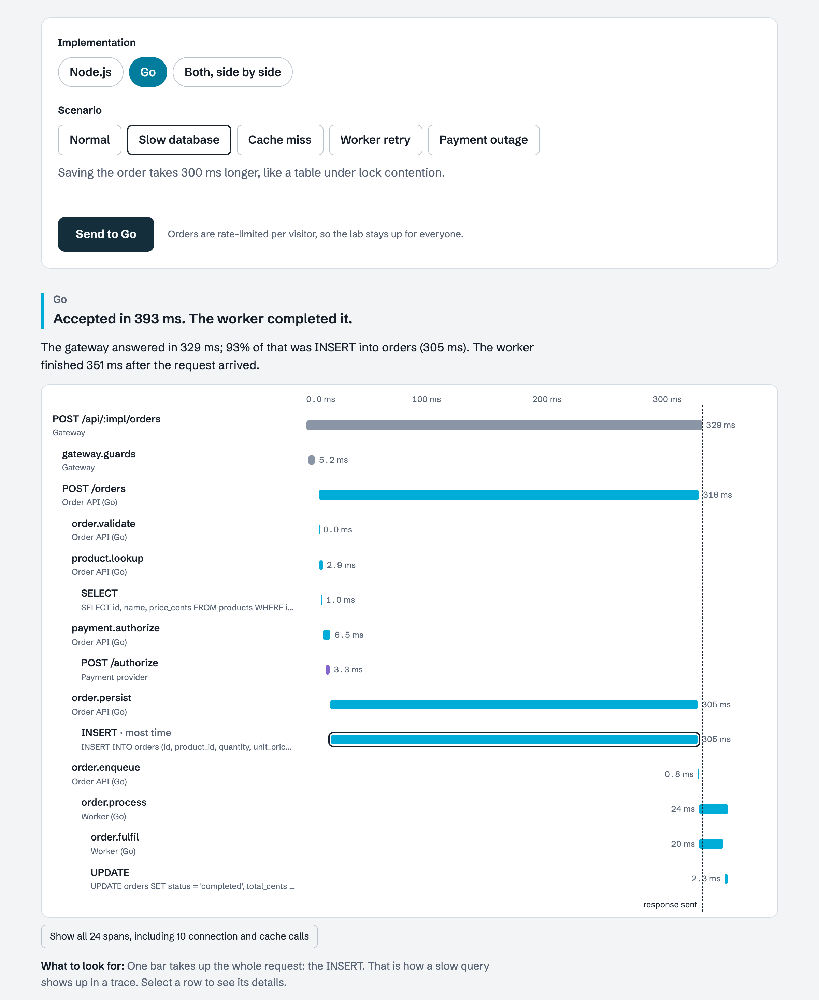

# Observability Lab

> Send a request. Trace its journey. Break the system. Find the bottleneck.

A small order-processing system built twice — **Node.js** and **Go** — behind one gateway, so the
same request and the same failure can be compared side by side. Instrumented with OpenTelemetry
(traces, metrics, logs), with controlled failure scenarios and a strict resource budget so it can
run next to production services on a small home server.

**Try it live at [lab.mge.my.id](https://lab.mge.my.id)**, or read the
[case study](https://dev.mge.my.id/observability-lab/).



```
browser → gateway ─┬─ order-api-node → Postgres / Redis → stream → worker-node
                   └─ order-api-go   → Postgres / Redis → stream → worker-go
```

## Quick start

Requirements: Docker, Node 24, pnpm, Go 1.26.

```sh
docker compose -f infra/compose.yaml -f infra/compose.dev.yaml up -d --build
./scripts/smoke.sh
pnpm install && pnpm test:contract
```

The demo page: http://127.0.0.1:8090 (pick Node.js, Go or both and a scenario, send an order, see
its trace). Grafana: http://127.0.0.1:3000 → Dashboards → Observability Lab → Lab overview, or Explore → Tempo
(every gateway response carries `X-Trace-Id`; from a trace you can open its logs, and from a log
line its trace).

```sh
curl -X POST http://127.0.0.1:8088/api/go/orders \
  -H 'content-type: application/json' \
  -d '{"productId":"demo-001","quantity":2,"scenario":"slow-db"}'
```

Then look at it from the telemetry side:

```sh
node scripts/waterfall.ts <trace-id>                      # one trace as a text waterfall
scripts/experiment.sh /tmp/run go slow-db RATE=4          # k6 load run (Docker), ~90 s
node scripts/trace-stats.ts --run /tmp/run                # which span the time goes to
```

## Results so far

- **Slow database:** the injected 300 ms `INSERT` is 98 % of the response in both languages. Under
  load it caps each API at ~33 orders/s, and the trace shows the new cost as waits for a pool connection.
- **Retries:** every `worker-retry` order completes after 3 attempts (~1.9 s), visible as three
  sibling spans in one trace, with no cost to the API's response time.
- **Circuit breaker:** while the payment provider hangs, the breaker turns 500 ms timeouts into
  ~10 ms refusals; in the Node run it kept 99 % of normal orders flowing vs 68 % without it.
- **Node vs Go:** on the same half core, Go took ~2× the traffic before its knee, used half the CPU
  per request, and starts in 0.23 s vs 5.5 s.
- **Telemetry isn't free:** the gateway's CPU limit and per-request access logs were found (and
  fixed) by measuring what each costs.

Details and caveats (measured on a MacBook with the server's container limits; a re-run on the
homelab is still open):
[docs/EXPERIMENTS.md](docs/EXPERIMENTS.md#results).

## Docs

Design, contract, resource budget and experiments are in [`docs/`](docs/README.md).

## Status

- [x] Milestone A — core services (Node + Go), gateway guards, contract tests
- [x] Milestone B — distributed tracing (OpenTelemetry → Collector → Tempo → Grafana)
- [x] Milestone C — slow database visible in traces (experiment 1, baseline vs degraded, pool saturation under load)
- [x] Milestone D — metrics, logs, dashboard, retry and circuit-breaker scenarios, experiments 2–6
- [x] Milestone E — public demo page: own-trace waterfall, compare mode, live numbers, offline replay
- [x] Milestone F — live at [lab.mge.my.id](https://lab.mge.my.id), case study at [dev.mge.my.id/observability-lab](https://dev.mge.my.id/observability-lab/)

## License

[MIT](LICENSE)
