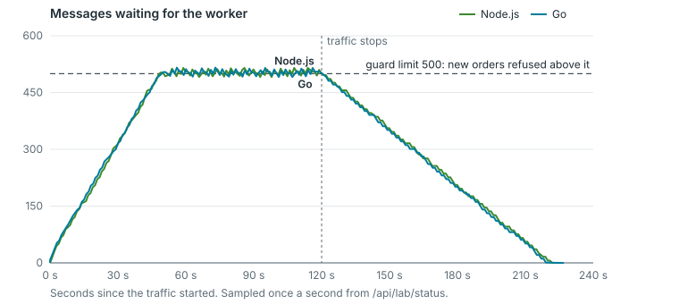

# Experiments

Each experiment answers one question with evidence. Recorded results feed the case study and the
offline fallback on the public page.

## Method

1. **Baseline**: scenario `none`, fixed traffic, record p50 / p95 / p99 latency, throughput,
   error rate, and representative traces.
2. **Degraded**: same traffic, one scenario switched on.
3. **Find it from telemetry alone**: start from the RED dashboard, drill into a slow trace, name
   the culprit span, confirm with logs.
4. **Improve** (where it applies): change code or config, re-run, compare with the baseline.
5. **Record**: numbers, screenshots, trace IDs, and what was learned — including surprises.

Rules for fair numbers:
- Same machine state: no deploys or backups during a run; note the host load.
- Warm-up period discarded (first 30 s).
- At least 3 runs per configuration; report the median run.
- Node and Go measured with identical container limits and traffic.
- k6 from the Mac over the LAN; note the 100 Mbps link.

## Planned experiments

### 1. Slow database (`slow-db`)
- **Question**: can a slow query be found from the trace alone?
- **Injection**: order `INSERT` takes +300 ms (`SLOW_DB_MS`).
- **Expected**: `order.persist` / the `INSERT` span dominates the waterfall; p95 rises by about
  300 ms; worker timing unchanged.
- **Evidence**: waterfall before/after, p95 chart.

### 2. Cache efficiency (`cache-miss`)
- **Question**: what does the product cache actually save?
- **Injection**: skip the Redis read on every request.
- **Expected**: an extra Postgres `SELECT` span per request; small latency rise at low traffic, larger
  under load as the DB pool queues.
- **Evidence**: span count per trace, DB query rate, latency at 10 / 50 / 100 RPS.

### 3. Worker retry (`worker-retry`)
- **Question**: are retries and recovery visible?
- **Injection**: processing fails twice, succeeds on the third attempt.
- **Expected**: one trace with three `order.process` attempts (error, error, ok), `attempts = 3` on
  the order, error logs linked to the trace.
- **Evidence**: trace with retry spans, logs panel, time-to-complete.

### 4. Dependency timeout (`dependency-timeout`)
- **Question**: does a timeout + circuit breaker protect the API when a dependency hangs?
- **Injection**: fake dependency answers slowly; API call has a timeout.
- **Expected**: without breaker, p95 equals the timeout and in-flight requests pile up; with breaker,
  requests fail fast while open, then recover (half-open → closed).
- **Evidence**: latency and error-rate charts across the open/close cycle, breaker state metric.

### 5. Node vs Go under load
- **Question**: where do the runtimes actually differ for this workload?
- **Method**: same k6 ramp against `/api/node` and `/api/go`, identical limits.
- **Measure**: throughput at the knee, p95/p99, memory (RSS), CPU, cold start time, image size.
- **Expected**: similar at low load (Postgres dominates); differences in memory, tail latency and the
  saturation point. Report what is measured, even if the difference is small.

### 6. Cost of telemetry
- **Question**: what do access logs, metrics and the gateway's CPU limit cost per request?
- **Method**: same traffic under different settings, CPU per request from the Docker API, 3 rounds.
- **Added in Milestone D** after the first load tests came out far slower than Milestone C.

### 7. Queue backlog and load shedding
- **Question**: what happens when producers outrun the worker?
- **Method**: scale worker work time up (`WORKER_WORK_MS`), push steady traffic, watch the backlog
  grow until the gateway's backlog guard sheds load, then stop and time the drain.
- **Evidence**: backlog chart, `503 reason=backlog` rate, how long accepted orders waited, recovery
  time.

## Result template

```markdown
## <Experiment name> — <date>

**Question:**
**Setup:** commit, impl(s), scenario, traffic profile, host load at start

| Metric | Baseline | Degraded | Improved |
|---|---|---|---|
| p50 | | | |
| p95 | | | |
| p99 | | | |
| Throughput (req/s) | | | |
| Error rate | | | |

**How it was found:** dashboard → trace → span → log (with trace IDs)
**Screenshots:**
**What we learned:**
**Trade-offs / follow-ups:**
```

## Tooling

| Tool | What it does |
|---|---|
| `load/orders.js` | k6 profile: steady (`RATE`) or stepped (`STAGES=10:30s,20:30s`) arrival rate, discarded warm-up, per-step latency, status counts and exact time windows in `summary.json` |
| `scripts/experiment.sh` | Runs k6 in Docker (`grafana/k6:2.3.0`), records lab guard status before/after and `docker stats` every 10 s |
| `scripts/trace-stats.ts` | Finds every trace of one implementation + scenario in a time window (TraceQL) and ranks spans by self time, i.e. names the culprit from telemetry alone |
| `scripts/waterfall.ts` | Prints one trace as a text waterfall |
| `experiments/<n>/run.sh`, `analyse.ts` | Runs an experiment end to end; writes `report.md`, `report.json` and saves example traces as JSON (Tempo keeps traces for 48 h) |

Tempo runs with half a CPU, where a trace-by-id lookup takes seconds. `trace-stats` therefore
fetches all spans of a window with one TraceQL search per 5 s chunk
(`{ <filter> } && { true } | select(span:name, span:parentID, resource.service.name, span:kind)`),
which returns structure and timing for ~250 traces in a few seconds.

## Results

### 1. Slow database — 2026-11-22 (Mac, Docker Desktop)

**Question:** can a slow query be found from the trace alone, and what does it cost beyond its own
300 ms?

**Setup:** load tooling and services at commit `b888911`, both implementations, scenarios `none` and
`slow-db` (`SLOW_DB_MS=300`), identical container limits, DB pool 10 per API. k6 in Docker on the
same Mac against the dev gateway. Part A: 4 req/s, 30 s warm-up + 60 s measured, 3 interleaved
rounds, median run by p95. Part B: 10 → 50 req/s in 30 s steps, gateway rate limit lifted, in-flight
guard (20) left on. Raw data, full tables and saved traces:
[`experiments/01-slow-db/results/mac-2026-11-22/`](../experiments/01-slow-db/results/mac-2026-11-22/report.md).
These are Mac numbers; the homelab re-run is part of Milestone F.

#### Part A — baseline vs degraded (4 req/s)

| Metric (k6, client side) | Node none | Node slow-db | Go none | Go slow-db |
|---|---|---|---|---|
| p50 | 11.3 ms | 316.4 ms | 9.8 ms | 314.3 ms |
| p95 | 21.3 ms | 329.3 ms | 18.2 ms | 324.2 ms |
| p99 | 39.7 ms | 344.8 ms | 25.8 ms | 330.0 ms |
| p95 range over 3 runs | 19.7–21.5 | 328.3–330.2 | 17.0–18.8 | 323.1–338.3 |
| Throughput | 4 req/s | 4 req/s | 4 req/s | 4 req/s |
| Error rate | 0 / 722 | 0 / 722 | 0 / 721 | 0 / 723 |

Degradation: p50 +305 ms (Node) / +305 ms (Go), p95 +308 / +306 ms: the injected 300 ms plus a
few ms, nothing else moves.

**How it was found (telemetry only):** `trace-stats` over every trace of the median slow-db run
(241 Node, 240 Go) ranks the `INSERT` span first by self time: **305 ms, 98 % of the median
response** in both languages. Next in line is the gateway at ~2 ms. The worker's timing is
unchanged (`order.fulfil` ~21 ms), as expected: the slow part is before the queue.

```
a-go-slow-db-typical  total 331.6 ms, response 310.6 ms
POST /api/:impl/orders  gateway         310.6 ms  |█████████████████████████████████████████████   |
  gateway.guards        gateway           0.0 ms  |█                                               |
  POST                  gateway         308.8 ms  |█████████████████████████████████████████████   |
    POST /orders        order-api-go    307.1 ms  |████████████████████████████████████████████    |
      product.lookup    order-api-go      0.3 ms  |█                                               |
      order.persist     order-api-go    304.9 ms  |████████████████████████████████████████████    |
        pool.acquire    order-api-go      0.0 ms  |█                                               |
        INSERT          order-api-go    304.7 ms  |████████████████████████████████████████████    |
      order.enqueue     order-api-go      1.6 ms  |                                            █   |
        order.process   worker-go        22.6 ms  |                                            ███ |
```

#### Part B — the same slow query under rising load

| Target req/s | Node accepted/s | Node p50 / p95 | Node pool wait p50 | Go accepted/s | Go p50 / p95 | Go pool wait p50 | 503 (Node / Go) |
|---|---|---|---|---|---|---|---|
| 10 | 10.0 | 311 / 342 ms | 0 ms | 10.0 | 310 / 317 ms | 0 ms | 0 / 0 |
| 20 | 20.0 | 308 / 318 ms | 0 ms | 20.0 | 307 / 318 ms | 0 ms | 0 / 0 |
| 30 | 30.0 | 306 / 410 ms | 0 ms (p95 55) | 30.0 | 305 / 361 ms | 0 ms | 0 / 0 |
| 40 | **33.3** | 544 / 604 ms | **243 ms** | **33.3** | 574 / 606 ms | **273 ms** | 203 / 201 |
| 50 | **33.0** | 522 / 601 ms | **245 ms** | **33.1** | 558 / 604 ms | **267 ms** | 510 / 508 |

Without the slow query, both implementations take 50 req/s at p50 3–4 ms with no pool wait.

At low load the slow query costs exactly its own 300 ms. But it also holds one of the 10 pool
connections for 300 ms, so each API can finish at most 10 / 0.3 s ≈ **33 orders/s**, and that is
exactly where both implementations flatten out. Past that point:

- The **INSERT span still reads ~302 ms**. Looking at the query alone would say "nothing got worse".
- A second span grows: the wait for a pool connection (`pool.acquire` in Go, `pg-pool.connect` in
  Node) jumps from 0 to ~250–270 ms. Response time roughly doubles to ~550–600 ms.
- The gateway's in-flight guard (20 concurrent) turns the excess into fast `503`s instead of an
  ever-growing queue. Accepted throughput stays at 33/s and latency stays bounded at ~600 ms.

```
b-go-slow-db-50rps-slowest  total 696.1 ms, response 674.7 ms
POST /api/:impl/orders  gateway         674.7 ms  |███████████████████████████████████████████████ |
  POST                  gateway         673.9 ms  |██████████████████████████████████████████████  |
    POST /orders        order-api-go    572.5 ms  |       ███████████████████████████████████████  |
      order.persist     order-api-go    571.9 ms  |       ███████████████████████████████████████  |
        pool.acquire    order-api-go    270.4 ms  |       ███████████████████                      |
        INSERT          order-api-go    301.4 ms  |                         █████████████████████  |
```

**What we learned:**
- A slow query is trivial to find in a trace (98 % of the response in one span). The interesting
  part is its second-order cost: it turns the connection pool into the bottleneck. Only a trace
  that also records the pool wait shows that. Node needed `instrumentation-pg`'s connect spans
  turned on for this (they were off in Milestone B).
- Node and Go behave the same here: the limit is Postgres connections × query time, not the
  runtime. Node vs Go differences belong in experiment 5 (CPU-bound load), not in this one.
- The in-flight guard works as designed: overload becomes 503s with `reason=inflight`, and
  accepted requests keep a bounded latency.

**Trade-offs / follow-ups:**
- Raising the pool size moves the ceiling (20 connections ≈ 66/s) but costs Postgres memory and
  only hides the slow query. The fix is the query itself. A per-request DB timeout would bound the
  damage.
- **CPU throttling (for Milestone D):** both `none` runs show p99 spikes of 100–380 ms and a
  ~100 ms gap between the gateway's client span and the API's server span in the slowest traces.
  The gateway is capped at `cpus: 0.5`; its cgroup shows 489 throttled periods out of 1314 (33 s
  throttled) over the part B runs, and `order-api-node` 713 periods (53 s). CFS throttling stalls
  a process for the rest of a 100 ms period, which matches the size of the spikes. Next: put
  `cpu.stat` throttling into the metrics (Milestone D) and check whether the throttled periods line
  up with the slow requests before changing any limit.


### Milestone D experiments — 2026-11-22 (Mac, Docker Desktop)

Common setup: all services as committed at the end of Milestone D (per-request access logs off,
gateway 1 CPU, order APIs 0.5 CPU / 128 MiB, DB pool 10), k6 in Docker on the same Mac. Full tables,
raw data and saved traces are in each `experiments/<n>/results/mac-2026-11-22/report.md`.

**A caution about this machine.** Docker Desktop runs ~19 containers plus k6 on 8 virtual CPUs.
Absolute numbers drift between runs made an hour apart (experiment 6: the same setting measured
5–7 ms gateway CPU per request in the morning pass and 10–12 ms later), and short whole-VM stalls
happen (one is dissected under experiment 2). Comparisons inside one experiment, run back to back
and interleaved, are what these results rely on. The homelab re-run (Milestone F) gives the
absolute numbers.

### 2. Cache efficiency (`cache-miss`)

**Question:** what does the product cache actually save?
**Setup:** `none` vs `cache-miss` at 10, 25 and 50 req/s (30 s steps), both implementations.

| | Node none | Node cache-miss | Go none | Go cache-miss |
|---|---|---|---|---|
| Traces with a Postgres `SELECT` in `product.lookup` | 0–2 % | 99–100 % | 0–1 % | 97–100 % |
| `product.lookup` p50 (10 / 25 / 50 req/s) | 0.44 / 0.32 / 0.51 ms | 1.50 / 0.90 / 1.04 ms | 0.34 / 0.22 / 0.24 ms | 0.76 / 0.54 / 0.80 ms |
| DB operations per request (order API) | 1.0 | 2.0 | 2.0 | 4.0 |
| Request p50 at 25 req/s | 12.1 ms | 11.1 ms | 9.5 ms | 10.6 ms |

(Go's DB operation count is twice Node's because `otelpgx` counts prepare and execute separately;
both double with `cache-miss`.)

**Found from telemetry:** every `cache-miss` trace has the extra `SELECT` span under
`product.lookup`, and the span metrics show the order API's Postgres query rate doubling. The cache
saves about 0.5–1 ms per request and half of the API's queries.
**What we learned:** at ≤ 50 req/s Postgres has plenty of headroom (peak 9–16 % of a core either
way), so end-to-end latency does not move measurably. Here the cache's value is in database load,
not in user-facing latency. It would matter once Postgres is shared or slower, which this lab can't
show at these rates. Reporting "no visible latency difference" is the honest result.

**An anomaly, diagnosed from telemetry alone.** Go `none` at 25 req/s had 273 refused requests and a
1.65 s p95 between two clean steps. trace-stats: `payment.authorize` in 94 % of traces but the
provider's server span in only 64 %, so about 30 % of requests never called the provider. Logs: the
**healthy** `payment` breaker opened at 10:39:35 and closed at 10:39:45. The slowest trace shows why:
a Redis `GET` took 669 ms, the `INSERT` 487 ms, `XADD` 545 ms, even the gateway's `xinfo` 130 ms,
all at once and in different processes. That is a whole-VM stall of ~3 s, enough for 5 payment
timeouts in a row. **Lesson:** "open after 5 consecutive failures" is too twitchy. A 3 s blip
took the payment path down for 10 s (266 orders refused). A failure *rate* over a window with a
minimum number of calls, as resilience libraries do, would ride this out.

### 3. Worker retry (`worker-retry`)

**Question:** are retries and recovery visible?
**Setup:** `worker-retry` vs `none` at 5 req/s for 60 s, both implementations.

| | Node none | Node worker-retry | Go none | Go worker-retry |
|---|---|---|---|---|
| Orders / completed / failed | 299 / 299 / 0 | 301 / 301 / 0 | 301 / 301 / 0 | 299 / 299 / 0 |
| Attempts per order | 1.00 | **3.00** | 1.00 | **3.00** |
| Time to complete p50 / p95 | 25 / 33 ms | **1942 / 2063 ms** | 23 / 35 ms | **1930 / 2048 ms** |
| "retry scheduled" log lines per order | 0 | 2.02 | 0 | 2.02 |
| API p95 (k6) | 32.5 ms | 60.3 ms | 43.9 ms | 33.8 ms |

**How it shows up:** each order has one trace with three `order.process` spans side by side under
`order.enqueue` (error, error, ok), each with `lab.attempt` and, on failures, `lab.retry.delay_ms`.
Each failure also leaves a warning log linked to the trace, and Postgres has `attempts = 3`.
Completion takes ~1.9 s: 0.5 s + 1 s of backoff, plus up to 250 ms each time for the retry loop to
move the entry back to the stream, plus the work. (2.02 log lines per order = retries of orders
created just before the window.)
**What we learned:** retries cost the client nothing (the API answers before the worker runs; API
p95 is in the same range for both scenarios), and nothing is lost: every order completed in both
languages. Not covered here: the "gave up after 3 attempts" path is in the code but no scenario
triggers it.

### 4. Dependency timeout and circuit breaker (`dependency-timeout`)

**Question:** does a timeout + circuit breaker protect the API when a dependency hangs?
**Setup:** through the gateway (in-flight limit 20), for 180 s: 10 req/s normal orders + 40 req/s
`dependency-timeout` at the same time. The degraded payment provider hangs 3 s for the first 30 s
of every minute; the API's payment timeout is 500 ms. Breaker on vs off (`BREAKER_ENABLED`).
Requests are split by whether they were sent during an outage window.

Node, during the outage windows:

| | Breaker on | Breaker off |
|---|---|---|
| Normal orders accepted | **888 / 899 (99 %)** | 614 / 901 (68 %) |
| Normal orders p95 | 278 ms | 567 ms |
| `dependency-timeout` requests p50 | **9 ms** (98 % `503 circuit-open`) | 514 ms (2,463 × `504` timeout) |
| Peak in-flight at the gateway | 11 | **20 (the limit)** |
| Refused by the in-flight guard (whole run) | 425 | 1,994 |

- With the breaker **off**, every degraded request holds a gateway slot for the full 500 ms timeout.
  40 req/s × 0.5 s = 20 slots, exactly the in-flight limit, so the gateway starts refusing
  **normal** orders too (286 refused in the outage windows). One slow dependency takes capacity
  from traffic that doesn't use it.
- With the breaker **on**, it opened 0.6–0.7 s after each outage began (5 timeouts). Degraded
  requests then fail in ~10 ms and normal orders are barely touched.
- **Recovery:** the breaker closed 1.7–1.8 s after each outage ended (the next probe after the
  10 s open period found the provider healthy). The cost of the breaker: up to 10 s of refusing
  requests that would have worked again. Visible on the dashboard's breaker timeline and in the
  logs (`circuit breaker open / half-open / closed`, linked to the trace of the request that
  caused it).

Go: the effect on the degraded traffic was the same in both attempts. During outages `dependency-timeout`
requests had a p50 of 24–38 ms with the breaker on (99 % `503 circuit-open`) vs 509–517 ms with it
off. The breaker opened 0.6–1.9 s after an outage began and closed 1.8–7.5 s after it ended. **The
effect on normal orders was inconclusive for Go:** both breaker-on runs coincided with the Mac being
overloaded (healthy-window p50 87 ms and 252 ms vs ~18–55 ms in the breaker-off runs; in the second
attempt even the gateway's host-load guard fired, at a Docker VM load above 16). An open Grafana
dashboard refreshing 24 panels every 10 s on the same VM is a likely contributor (default refresh
is now 30 s). This gets a clean re-run on the homelab
([attempt 1](../experiments/04-dependency-timeout/results/mac-2026-11-22/report.md),
[attempt 2](../experiments/04-dependency-timeout/results/mac-2026-11-22-go-rerun/report.md)).

**Trade-offs:** see experiment 2's anomaly for the flip side. "5 consecutive failures" also opens
on a 3 s infrastructure blip. Production would use a failure rate over a sliding window with a
minimum number of calls, a shorter or adaptive open period, and a breaker per downstream *host*
rather than per process.


### 5. Node vs Go under load

**Question:** where do the runtimes actually differ for this workload?
**Setup:** k6 → each order API directly (no gateway), scenario `none`, 50 → 400 req/s in 30 s
steps, identical limits (0.5 CPU, 128 MiB, pool 10), same Postgres, Redis and fake payment.

| Target req/s | Node accepted/s | Node p50 / p95 | Node CPU / throttled | Go accepted/s | Go p50 / p95 | Go CPU / throttled |
|---|---|---|---|---|---|---|
| 50 | 50.0 | 11 / 555 ms | 0.30 / 24 % | 50.0 | 9 / 63 ms | 0.21 / 7 % |
| 100 | **60.1** | 264 / 1525 ms | 0.38 / 62 % | **100.0** | 8 / 34 ms | 0.29 / 7 % |
| 200 | 18.2 | 386 / 3465 ms | 0.41 / 66 % | **128.2** | 8 / 580 ms | 0.37 / 46 % |
| 300 | 0 | 409 / 5642 ms | 0.48 / 89 % | 283.7 | 1905 / 3245 ms | 0.50 / 100 % |
| 400 | 0 | 1212 / 4261 ms | 0.50 / 100 % | 31.2 | 10571 / 28776 ms | 0.48 / 81 % |

| | Node | Go |
|---|---|---|
| CPU per request (from the 50 and 100 req/s steps) | ~6 ms | ~2.9 ms |
| Memory at 50 req/s → 400 req/s | 77 → 121 MiB | 26 → 128 MiB (5,528 goroutines) |
| Container start → listening | 5.5 s | 0.23 s |
| Image size | 207 MB | 30 MB |

**What we learned:**
- On the same half core, Go handled about **twice the traffic** before its knee (100+ vs ~60 req/s)
  and used about half the CPU per request, including full OpenTelemetry instrumentation.
- Both collapse the same way, and it isn't the database: CPU starvation makes the 500 ms payment
  timeout fire on the **healthy** provider, five timeouts open its breaker, and the API then refuses
  everything with `503 circuit-open`. A wall-clock timeout can't tell "the dependency is slow" from
  "I am too starved to read its answer". Fixes: load shedding before saturation (the gateway's
  in-flight guard does this for real traffic), and a breaker that ignores failures while the
  process itself is throttled.
- Go's failure mode is memory, not CPU: past saturation, goroutines pile up (5,528 at 400 req/s)
  and it reaches its 128 MiB limit. Node's single event loop just gets slower.
- Start-up: 5.5 s vs 0.23 s, and 207 MB vs 30 MB. That matters for scaling out and cold starts, not
  for this demo.
- Node's event-loop delay column is missing from these runs: the runtime instrumentation was
  sampling every 5 s and every reading included that interval (fixed afterwards, see experiment 6
  notes).

### 6. Cost of telemetry

**Question:** what do access logs, metrics and the gateway's CPU limit cost per request?
**Why it exists:** the first Milestone D load test was far slower than Milestone C (Node p95 356 ms
at 10 req/s vs 16 ms). An exploratory single-run pass
([`results/mac-2026-11-22-exploratory`](../experiments/06-telemetry-cost/results/mac-2026-11-22-exploratory/report.md))
pointed at per-request access logs and at the gateway being CPU-throttled, so both were changed
and this experiment checks the effect properly.
**Setup:** 40 req/s, scenario `none`, 40 s, through the gateway; 4 settings × 2 implementations ×
3 interleaved rounds; CPU per container from the Docker Engine API, median of the rounds.

| Setting | Impl | App CPU per request (range) | Loki + collector | Gateway throttled | p95 | Refused |
|---|---|---|---|---|---|---|
| access logs on | node | 28.9 ms (22.7–36.0) | 7.2 ms | 9 % | 2648 ms | 407 |
| access logs on | go | 26.0 ms (22.2–27.7) | 8.1 ms | 18 % | 1768 ms | 386 |
| **access logs off (default)** | node | 25.5 ms (21.9–32.3) | 4.5 ms | 12 % | 1206 ms | 675 |
| **access logs off (default)** | go | 24.1 ms (15.9–24.3) | 6.4 ms | 11 % | 1061 ms | 243 |
| traces only | node | 26.3 ms (21.9–30.3) | 3.8 ms | – | 873 ms | 611 |
| traces only | go | 20.7 ms (19.7–20.8) | 4.5 ms | – | 488 ms | 46 |
| gateway at 0.5 CPU | node | 25.8 ms (22.8–32.3) | 4.9 ms | **55 %** | 3386 ms | 873 |
| gateway at 0.5 CPU | go | 19.9 ms (18.9–27.4) | 6.0 ms | **44 %** | 1696 ms | 306 |

App CPU = gateway + order API + worker + fake payment. "Refused" is out of ~1,600 requests.

**What we learned:**
- **The gateway's CPU limit is the big one.** At 0.5 CPU it was throttled in 44–55 % of
  scheduling periods, which roughly doubled p95 and refused more requests for both implementations.
  Node's GC and libuv threads burst above half a core within a single 100 ms period even when the
  average is lower. Every request passes the gateway, so it now has 1 CPU.
- **Access logs cost something, but less than the noise here:** turning them off saved ~8–12 % of
  app CPU at the median (ranges overlap) and clearly less work for Loki and the collector (Loki
  3.8 → 2.2 ms per request for Node). They repeat what traces and span metrics already record, so
  off by default is still right.
- **Metrics and warning logs** cost Go ~15 % of app CPU (24.1 → 20.7 ms) and are within the noise
  for Node. Traces stay on everywhere; they are the point of the lab.
- **Even traces-only is CPU-heavy on this Mac**: ~20–26 ms of CPU per request across four
  services. That is why tail latency at 40 req/s is far above Milestone C's numbers: the extra
  payment hop, metrics, three more telemetry backends and the noisy shared VM all add up. The
  homelab run will show how much of it is the Mac.
- A mistake caught along the way: Node's runtime instrumentation was configured with
  `monitoringPrecision: 5000`. That is the event-loop sampling interval, and every reading includes
  it, so the event-loop delay metric read ~5 s at idle. Now 10 ms: idle p50 ~11 ms (10 ms interval +
  <1 ms real delay). The dashboard subtracts the interval.

### 7. Queue backlog and load shedding — 2026-11-23 (homelab)

**Question:** what happens when orders arrive faster than the worker can finish them?
**Setup:** on the homelab server (the first experiment run there), one implementation at a time.
The worker's simulated work raised from 20 ms to 2,000 ms per order (it takes 10 orders at a time,
so it finishes about 5 a second); 15 orders a second for 120 s through the gateway, scenario
`none`; then no traffic until the queue is empty. The per-IP order limit was lifted for k6; the
in-flight, host-load and backlog guards stayed on. k6 ran on the Mac over SSH, not through the
public tunnel. Script and raw data: [`experiments/07-queue-backlog`](../experiments/07-queue-backlog/run.sh),
[report](../experiments/07-queue-backlog/results/homelab-2026-11-23/report.md).



| | Node.js | Go |
|---|---|---|
| Offered | 1,801 (15/s × 120 s) | 1,801 |
| Accepted (202) / refused (503) | 1,086 / 715 | 1,082 / 719 |
| Backlog over the limit at | 49 s | 50 s |
| Peak backlog | 515 | 516 |
| Accepted per second, before / while capped | 15.0 / 4.8 | 14.7 / 4.8 |
| Worker throughput | 4.9 per s | 5.0 per s |
| Wait until done (`processed_at − created_at`), orders of the first second, p50 | 2.9 s | 4.0 s |
| Wait until done while capped, p50 / p95 / max | 102 / 104 / 104 s | 101 / 103 / 104 s |
| Time to drain after the traffic stopped | 103 s | 105 s |
| Shed reasons | backlog only | backlog only |
| Host load1, peak (guard at 4) | 1.10 | 1.10 |

Every accepted order completed: no failures, nothing lost or stuck in the queue.

**What we learned:**
- **The guard does what it was built for.** The backlog grew at the expected rate (15 in, 5 out),
  crossed 500 at ~50 s (500 / 10 per second), and from then on the gateway admitted exactly what
  the worker could finish (4.8 a second) and refused the rest at once, with a clear message and
  `Retry-After: 5` (p95 of all responses, accepted and refused, under 75 ms). Host load never passed 1.1, so the other sites on the
  server didn't notice. After the traffic stopped, the queue drained without anyone touching it.
- **A limit counted in messages is really a limit in waiting time, and it depends on the worker's
  speed.** 500 messages at 5 a second meant every order accepted while capped waited ~100 s for
  its result. At the normal 20 ms of work, the same 500 is about a second. The number that matters
  to a user is the wait, so the guard should be "refuse when the estimated wait (backlog ÷ recent
  completion rate) is over N seconds", or at least alert on the age of the oldest message.
- **The overshoot is small**: the guard reads the backlog through a 1-second cache, so up to ~15
  extra orders get in (peak 516 against 500). Cheaper than asking Redis on every request.
- **Node.js and Go are identical here**, as they should be: the worker's sleep dominates, so this
  tests the queue mechanics, not the language.

**Trade-offs / follow-ups:**
- A time-based limit needs a completion rate that is meaningful at low traffic; with almost no
  orders it would swing wildly, so keep the count limit as a floor and add the time limit on top.
- While a run is going, public visitors who pick the implementation under test get the same "queue
  is backed up" answer. Each run takes about 4 minutes.

## Observations to follow up

- **Gateway → order API gap (Milestone B, checked in C)**: the ~40 ms gap seen in Milestone B was a
  cold start: it appeared only on the first request after the stack had been idle for 16 h (the
  first request through each path also paid for new Postgres connections, `pg.connect` ~29 ms).
  Warm requests show ~1 ms between the gateway's client span and the API's server span. When
  undici's keep-alive connection has expired (default 4 s idle), the next request pays ~3–5 ms for a
  new TCP connection. Not worth a change at demo traffic; a longer `keepAliveTimeout` would remove
  it.
- **CPU throttling under load (Milestone C)**: see experiment 1 follow-ups.
