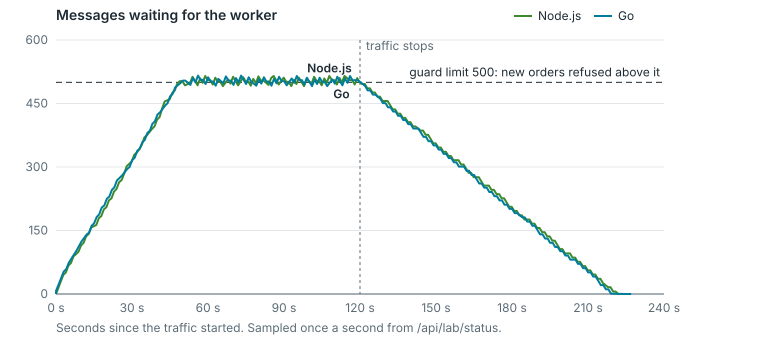

# Experiment 7 — queue backlog and load shedding: results

Source: `experiments/07-queue-backlog/results/homelab-2026-11-23`. Generated by `analyse.ts`.

Accepted and worker rates come from Postgres (`created_at`, `processed_at`) for the orders of the measured window; "while capped" starts 10 s after the backlog first crossed the limit. Wait = `processed_at − created_at`. Shed by reason = `increase(lab_gateway_shed_total)` over the run (Prometheus extrapolates, so ≈; k6's 503 count is exact). Recovery = end of traffic until the backlog is 0.

| Impl | Worker work | Offered | k6 status | Backlog over limit at | Peak backlog | Accepted before / while capped | Worker rate | Wait, first second (p50) | Wait while capped p50 / p95 / max | Shed by reason | Recovery | Peak load1 |
|---|---|---|---|---|---|---|---|---|---|---|---|---|
| node | 2000 ms | 15/s × 120s (1801) | 202×1086 503×715 | 49 s | 515 | 15.0 / 4.8 per s | 4.9 per s | 2.9 s | 102.0 s / 103.9 s / 104.4 s | backlog ≈743 | 103 s | 1.10 |
| go | 2000 ms | 15/s × 120s (1801) | 202×1082 503×719 | 50 s | 516 | 14.7 / 4.8 per s | 5.0 per s | 4.0 s | 101.3 s / 103.1 s / 103.5 s | backlog ≈735 | 105 s | 1.10 |

Orders in the window: node 1086 completed, 0 failed, 0 still queued; go 1082 completed, 0 failed, 0 still queued.

